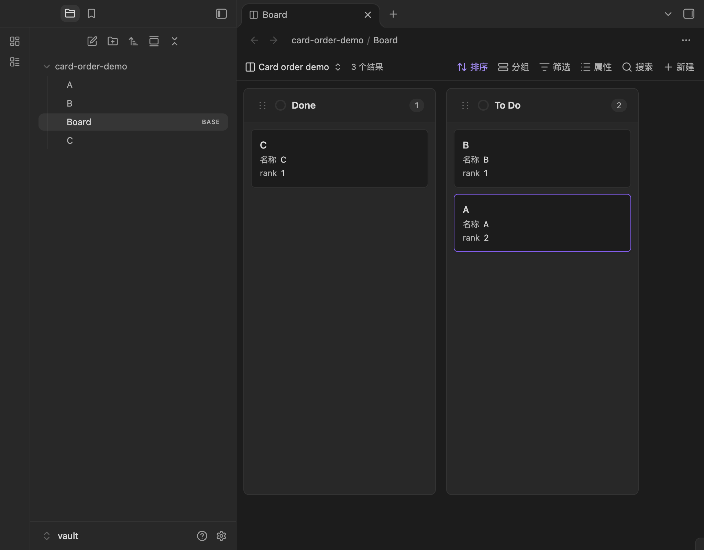
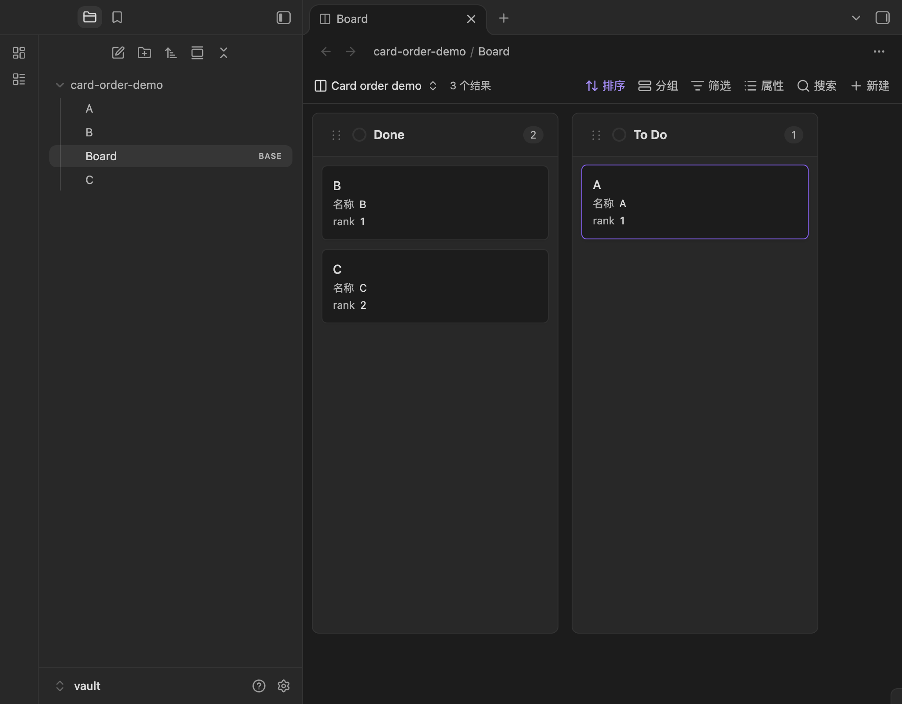

# Card order verification

Tested on Obsidian Desktop 1.14.4 in an isolated vault with the production bundle. The board had `Card order: note.rank`, `Group by: note.status`, and an active Base Sort by file name descending.

Starting notes:

| Note | status | rank |
| --- | --- | --- |
| A | To Do | 1 |
| B | To Do | 2 |
| C | Done | 1 |

1. Drag B before A in To Do. The files become B=1 and A=2.
2. Drag B before C in Done. B has status=Done and rank=1, C=2, and A=1 in To Do.
3. Compare the persisted Markdown and the rendered board. Unrelated fields and the Markdown body remain intact.

The screenshots below were captured from the actual Obsidian window after those mouse drags.

Automated checks: formatting, lint, TypeScript, production build, and 257 tests. Coverage includes finite numeric values and numeric strings, missing/invalid ranks, invalid property selections, dense ranks in both affected cells, cross-swimlane moves, Base Sort precedence, switching persistence modes without migration, consecutive drags before the query catches up, write failure propagation, exact-byte preservation for unchanged ranks including YAML comments and CRLF, and production-bundle persistence to real Markdown files followed by a fresh view.

The atomic rank update returns the original file content when the current rank is already correct. Changed frontmatter is serialized using Obsidian's public YAML helpers. Multi-note updates are not one transaction; a failure can leave completed updates in place. Ranks are local to each visible column or swimlane/column cell. Other views need matching filters/grouping and ascending rank sorting to reproduce the order. Mobile gesture testing is pending.
